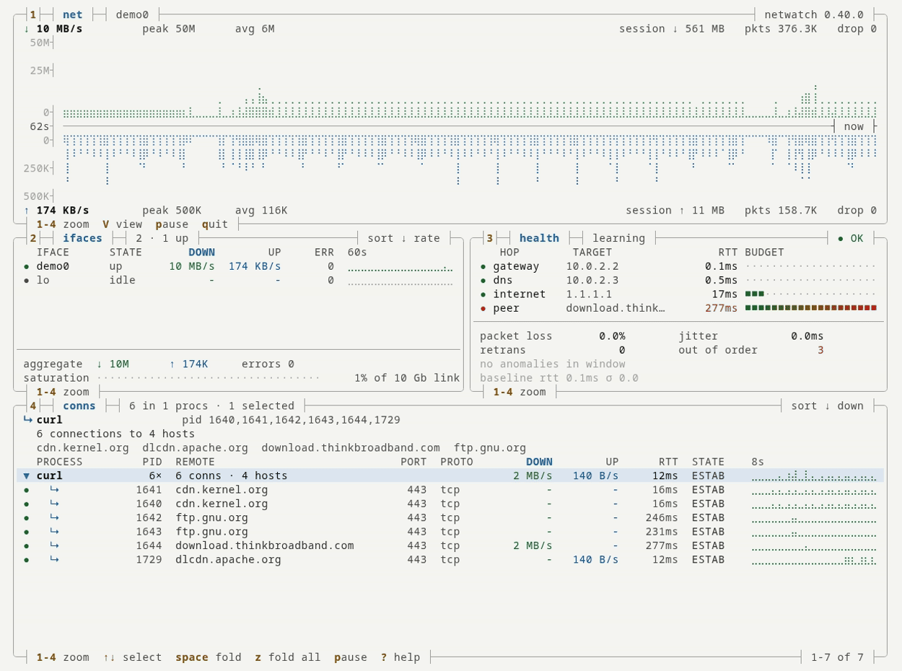

<h1 align="center">netwatch</h1>

<p align="center">
  <strong>Network diagnostics in your terminal.</strong><br>
  Linux, macOS, Windows and FreeBSD.
</p>

<p align="center">
  <a href="https://github.com/matthart1983/netwatch/actions/workflows/ci.yml?query=branch%3Amain"></a>
  <a href="https://github.com/matthart1983/netwatch/releases/latest"></a>
</p>

<p align="center">
  <a title="Tool of The Week on Terminal Trove" href="https://terminaltrove.com/netwatch/"></a>
</p>

<p align="center">
  
</p>

<p align="center">
  <em><code>netwatch --view dense</code>. Four boxes, no chrome, every keybind on a border. Download grows up from the axis, upload grows down.</em>
</p>

<p align="center">
  Featured in <a href="https://www.youtube.com/watch?v=TBOtZ3mBktM&amp;t=112s">35 Self-Hosted Projects on GitHub</a> by Github Awesome.
</p>

One binary, no config. `netwatch` with capture permissions gives you live capture with L7 decode, process attribution where available, and a diagnostic engine that opens an issue when a learned baseline breaks and closes it when the fix holds.

## Install

```bash
brew install netwatch                 # macOS / Linux
scoop install netwatch                # Windows (needs Npcap)
cargo binstall netwatch-tui           # prebuilt binary (needs cargo-binstall)
cargo install netwatch-tui            # build from source, anywhere with Rust
paru -S netwatch-tui                  # Arch (AUR)
nix-shell -p netwatch                 # NixOS / Nix
conda install -c conda-forge netwatch # conda / mamba (Linux, macOS)
```

**Debian / Ubuntu** ([apt repository](https://matthart1983.github.io/netwatch/)):

```bash
curl -fsSL https://matthart1983.github.io/netwatch/apt/netwatch.gpg \
  | sudo tee /usr/share/keyrings/netwatch.gpg >/dev/null
echo "deb [signed-by=/usr/share/keyrings/netwatch.gpg] \
https://matthart1983.github.io/netwatch/apt stable main" \
  | sudo tee /etc/apt/sources.list.d/netwatch.list
sudo apt update && sudo apt install netwatch
```

**Fedora:** `sudo dnf copr enable matthart1983/netwatch && sudo dnf install netwatch`

**Container:** `docker run --rm -it --net=host --pid=host --cap-add=NET_RAW ghcr.io/matthart1983/netwatch`

**Binaries** for macOS, Linux (x86_64, aarch64, armv5te), FreeBSD (x86_64) and
Windows are on the
[releases page](https://github.com/matthart1983/netwatch/releases/latest), with
`.deb`, `.rpm`, checksums and signed provenance. The Linux builds are static and
need nothing installed; Windows needs [Npcap](https://npcap.com/#download).

**FreeBSD:** `netwatch-freebsd-x86_64` is built on FreeBSD 13.5 and
dynamically links the base system's libc and libpcap, so it needs FreeBSD 13 or
newer (it cannot be static). On anything older, build from source with
`cargo install netwatch-tui`.
[Verifying a download](docs/REFERENCE.md#verifying-a-download) ·
[every channel](docs/PACKAGING.md).

## Run

Packet capture needs elevated access. On Linux, grant `cap_net_raw,cap_bpf,cap_perfmon+eip` to a binary [restricted to a netwatch group](docs/REFERENCE.md#running-without-sudo-linux), or run the [systemd unit](packaging/systemd/netwatch.service). `sudo netwatch` works, but as root the sandbox is defence in depth only and containment is limited. See the [threat model](docs/THREAT-MODEL.md).

```bash
netwatch              # interfaces, connections, config. No privileges.
sudo netwatch         # works; root containment is limited
netwatch --lite       # one 80x24 screen
netwatch --view dense # four boxes, 130x44 or larger
```

`1` to `9` and `0` switch tabs, `V` cycles the three views, `?` shows every key.

### Without the TUI

```bash
netwatch doctor                          # what netwatch can see on this host, and why not
netwatch diagnose run --budget 30s       # one bounded diagnosis; exit 0 clean, 1 issue, 2 no evidence
netwatch diagnose run --format json      # the same, for scripts
netwatch daemon --metrics                # headless; Prometheus /metrics on 127.0.0.1:9464
netwatch uptime --since 7d               # outages this week: when, how long, and which hop failed
netwatch geoip update                    # download the offline GeoIP databases
netwatch --demo                          # replay a recorded Diagnose incident, no capture needed
```

`daemon` runs the same collectors with no screen; a [systemd unit](packaging/systemd/netwatch.service) and a [launchd agent](packaging/launchd/com.netwatch.agent.plist) ship with it, and [Prometheus export](docs/observability-export.md) lists the metrics. `--remote URL` with `NETWATCH_API_KEY` streams snapshots to a backend you run. Both stay accepted through 1.x, and what they do is experimental: the wire format may change. So are AI Insights, `netwatch resolver set` and `recover`, and the JSON in PCAPNG packet comments: [what that covers](docs/CAPABILITIES.md#experimental). [Every command and flag](docs/REFERENCE.md#command-line).

## The tabs

| # | Tab | Shows |
|---|-----|-------|
| 1 | Dashboard | Latency tiles, mirrored throughput, the link carrying it, connections rolled up per process |
| 2 | Connections | Every socket with process, PID, state, GeoIP, RTT, retransmits |
| 3 | Interfaces | Addresses, MTU, rates, errors, drops |
| 4 | Packets | Live decode, TLS 1.3 decryption, JA4, stream tracking, display filters, PCAPNG and PCAP export |
| 5 | Stats | Protocol breakdown and handshake-timing histogram |
| 6 | Topology | Machine, gateway, DNS, top hosts, traceroute, how long the connection has been up |
| 7 | Timeline | Connections by TCP state, with alerts |
| 8 | Processes | Bandwidth per process |
| 9 | Diagnose | Issue, cause, fix, verified close. `report.md` from the same objects |
| 0 | Egress | Learned destinations, promoted policy, drift |

[Every keybinding](docs/REFERENCE.md#keyboard-controls), [display filters](docs/REFERENCE.md#display-filters), [decoders](docs/REFERENCE.md#deep-packet-inspection), [themes](docs/REFERENCE.md#themes), [configuration](docs/REFERENCE.md#configuration).

## Views

`V` cycles all three without a restart; the collectors keep running.

| View | Size | For |
|---|---|---|
| Full | any | The ten tabs above |
| Lite (`--lite`) | 80x24 | An SSH session to a Pi, or a tmux split |
| Dense (`--view dense`) | 130x44+ | The hero image: four boxes, braille throughput, kernel TCP detail |

[Why they look like this](docs/DESIGN-0.30.md#8-dense-and-lite).

## Docs

| | |
|---|---|
| [Reference](docs/REFERENCE.md) | Keys, filters, decoders, configuration, permissions |
| [Stability](STABILITY.md) | What 1.0 promises, and what stays experimental |
| [Diagnose](docs/REFERENCE.md#how-it-works) | Baselines, the 30 rules, ranked causes, verified closes |
| [TLS decryption](docs/REFERENCE.md#tls-13--12-decryption) | Point `SSLKEYLOGFILE` at netwatch and read your own traffic |
| [Egress linting](docs/egress-linter-plan.md) | Observe destinations, promote a policy, alert on what you block |
| [Security and forensics](docs/REFERENCE.md#security--forensics) | Beaconing, scans, DNS tunnelling, JA4, the flight recorder |
| [Capability matrix](docs/CAPABILITIES.md) | Platform differences, diagnostic limits and verification scope |
| [Attribution evidence](docs/attribution.md) | Identity, freshness, coverage denominators and controlled results |
| [Doctor command](docs/doctor.md) | Read-only setup report, JSON capabilities and optional capture check |
| [Design 0.30](docs/DESIGN-0.30.md) | Why the screens look the way they do |
| [Architecture](docs/WIKI.md) | Runtime, source map, permissions model, how to build and verify |
| [AI Insights](docs/INSIGHTS.md) | Optional LLM commentary inside Diagnose, off by default. Experimental |
| [Prometheus export](docs/observability-export.md) | Exposed metrics and scrape config |
| [Packaging](docs/PACKAGING.md) | Every channel, and what updates it |
| [Changelog](CHANGELOG.md) | Every release |

Diagnose misread your network? [Open an issue](https://github.com/matthart1983/netwatch/issues/new?template=bug_report.md) with what you saw and the output of `netwatch diagnose run --format json`. It names your gateway and resolver addresses, so edit those out if you'd rather.

## Related

[syswatch](https://github.com/matthart1983/syswatch) and [diskwatch](https://github.com/matthart1983/diskwatch) share the layout and palette. [kernwatch](https://github.com/matthart1983/kernwatch) covers Linux scheduling, memory pressure and block I/O. [essh](https://github.com/matthart1983/essh) keeps remote shells alive across connection drops, with the same look.

## Thanks

Much of the packaging is other people's work. Dominiquini and kemelzaidan maintain [`netwatch-tui`](https://aur.archlinux.org/packages/netwatch-tui) and [`netwatch-tui-bin`](https://aur.archlinux.org/packages/netwatch-tui-bin) on the AUR, tomasrivera the [nixpkgs package](https://github.com/NixOS/nixpkgs/blob/nixos-unstable/pkgs/by-name/ne/netwatch/package.nix), [scillidan](https://github.com/scillidan) the [Scoop entry](https://github.com/ScoopInstaller/Main/blob/master/bucket/netwatch.json), [pavelzw](https://github.com/pavelzw) the [conda-forge feedstock](https://github.com/conda-forge/netwatch-feedstock), and the Homebrew maintainers took the formula into core. File packaging problems with them and netwatch bugs here.

[@lamchau](https://github.com/lamchau), [@fdncred](https://github.com/fdncred) and [@PeteE](https://github.com/PeteE) sent patches. Everyone who opened an issue with a repro or argued with a design decision is the reason the output is right on more terminals than mine.

## Contributing

[Discussions](https://github.com/matthart1983/netwatch/discussions), [issues](https://github.com/matthart1983/netwatch/issues), [CONTRIBUTING.md](CONTRIBUTING.md).

## License

MIT
